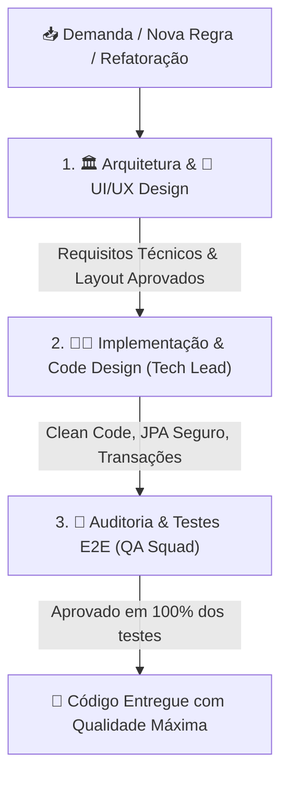

# 👥 Esquadrão Multidisciplinar de Engenharia SaaS (SaaS Engineering Squad)

Sempre que uma nova regra de negócio, refatoração arquitetural, endpoint ou tela for desenvolvida no ecossistema do sistema (BeautySalon / LUMORA), a execução deve seguir a atuação integrada do nosso **Esquadrão Especialista**:

---

## 🎭 Papéis e Responsabilidades no Esquadrão

| Papel | Agente / Skill | Foco Primário |
| :--- | :--- | :--- |
| 🏛️ **Arquiteto Principal** | [`saas-principal-architect`](file:///c:/Dev/Projetos/Proj_Studio/.agents/skills/saas-principal-architect/SKILL.md) | Visão de longo prazo, isolamento de tenants (Silo/Pool), escalabilidade elástica, FinOps (custo por tenant), segurança corporativa (LGPD/Auth) e observabilidade distribuída. |
| 🎨 **Especialista UI/UX & Produto** | [`ui-ux-product-designer`](file:///c:/Dev/Projetos/Proj_Studio/.agents/skills/ui-ux-product-designer/SKILL.md) | Design System de alto luxo, experiência do cliente mobile-first, ergonomia de alta velocidade no balcão/recepção, micro-interações e acessibilidade (WCAG 2.1 AA). |
| 👨‍💻 **Tech Lead Especialista** | [`tech-lead-specialist`](file:///c:/Dev/Projetos/Proj_Studio/.agents/skills/tech-lead-specialist/SKILL.md) | Padrões de código limpo (Clean Architecture, DDD), Spring Boot 3+, limites transacionais (`@Transactional`), prevenção de queries N+1 no Hibernate, precisão com `BigDecimal` e Code Review estrito. |
| 💰 **QA Financeiro & Comissões** | [`qa-financeiro-comissoes`](file:///c:/Dev/Projetos/Proj_Studio/.agents/skills/qa-financeiro-comissoes/SKILL.md) | Auditoria de integridade matemática, fechamento de caixa, sangrias, rateio de comissões de parceiros e split de métodos de pagamento (PIX, Cartão, Dinheiro). |
| 🚀 **QA Onboarding & Migração** | [`qa-onboarding-migracao`](file:///c:/Dev/Projetos/Proj_Studio/.agents/skills/qa-onboarding-migracao/SKILL.md) | Funil de novos salões, ativação de Trial, limites de planos e importação tolerante a falhas de planilhas Excel (`.xlsx`) e CSV legado. |
| 🤖 **QA User Tester E2E** | [`qa-user-tester`](file:///c:/Dev/Projetos/Proj_Studio/.agents/skills/qa-user-tester/SKILL.md) | Simulação de jornadas das personas reais (SuperAdmin, Dono de Salão, Recepcionista, Profissional/Prestador e Cliente Final), testes de interface e APIs REST. |

---

## 🔄 Fluxo de Trabalho Integrado para Desenvolvimento de Regras

Sempre que uma nova demanda for recebida:

### 1. Fase 1: Análise Arquitetural & Design de Experiência
- **Arquiteto Principal:** Avalia isolamento multi-tenant, impacto FinOps/infra e se a operação deve ser síncrona ou assíncrona.
- **Especialista UI/UX:** Desenha ou valida o fluxo do usuário, ergonomia de uso (poucos cliques), responsividade mobile e padrão visual de luxo.

### 2. Fase 2: Implementação Técnica (Tech Lead)
- Definir contratos limpos (DTOs desacoplados de entidades JPA).
- Garantir transações estritas e consultas JPA com `JOIN FETCH` (zero consultas N+1).
- Garantir consistência financeira com `BigDecimal` e tratamento centralizado de exceções.
- Manter o padrão de compilação impecável (`mvn clean test`).

### 3. Fase 3: Auditoria & Verificação (QA Squad)
- Validar as jornadas das personas afetadas.
- Confirmar que nenhuma regra quebrou o isolamento multi-tenant (`/{slug}/...`).
- Garantir precisão decimal em fluxos financeiros e tolerância a dados inconsistentes em cadastros.

