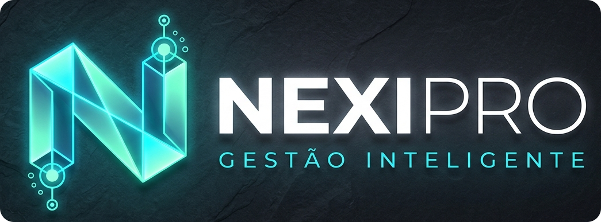

<p align="center">
  
</p>

<h1 align="center">✂️ NEXI PRO — Gestão Inteligente Multi-Tenant SaaS</h1>

<p align="center">
  <em>Ecossistema completo de alta performance para salões de beleza, clínicas de estética, barbearias e lash designers.</em>
</p>

<p align="center">
  <a href="https://github.com/BioCamargo/beautysalon-saas/actions">
    
  </a>
  
  
  
  
  
  
  
  
  
  
  
  
</p>

O **NEXI PRO** é uma plataforma empresarial completa desenvolvida com **Java 17 e Spring Boot 3.5**, projetada para transformar a operação, o fluxo de caixa, o agendamento e a retenção de clientes em salões de beleza, barbearias, clínicas de estética e lash designers. Construído sobre arquitetura **Multi-Tenant SaaS** (com isolamento estrito de dados por empresa via URL `/{slug}/`), o sistema combina renderização Server-Side de alta velocidade (Thymeleaf), Progressive Web App (PWA) e APIs RESTful documentadas com OpenAPI/Swagger.

---

## 📌 Sumário

1. [Módulos e Funcionalidades Principais](#-módulos-e-funcionalidades-principais)
2. [Arquitetura e Tecnologias](#-arquitetura-e-tecnologias)
3. [Documentação OpenAPI / Swagger](#-documentação-openapi--swagger)
4. [Estrutura do Banco de Dados](#-estrutura-do-banco-de-dados)
5. [Estrutura do Projeto](#-estrutura-do-projeto)
6. [Início Rápido (Quick Start)](#-início-rápido-quick-start)
7. [Contas e Dados Padrão](#-contas-e-dados-padrão)
8. [Resumo das Rotas da Aplicação](#-resumo-das-rotas-da-aplicação)
9. [Documentação Complementar](#-documentação-complementar)

---

## 🌟 Módulos e Funcionalidades Principais

### 1. 💼 Módulo Financeiro & Fluxo de Caixa
* **Abertura e Fechamento de Caixa Diário**:
  * Definição de saldo inicial / fundo de troco.
  * Lançamento de movimentações rápidas: Sangria, Reforço e Despesas Operacionais com trilha de auditoria.
  * Fechamento com conferência de valores (saldo esperado vs. saldo contado) e cálculo automático de sobras/faltas.
* **Comandas Inteligentes**:
  * Atendimento por cliente cadastrado ou venda rápida de balcão.
  * Lançamento de serviços e produtos de revenda na mesma comanda.
  * Split de pagamentos: PIX, Cartão de Crédito, Débito, Dinheiro e Voucher/Vale-Presente.
  * **Baixa Automática de Estoque**: produtos e insumos de serviços baixados no fechamento.
  * Cálculo dinâmico de comissão devida ao profissional executor/vendedor.

---

### 2. 📦 Módulo de Estoque & Ficha Técnica
* **Produtos de Revenda & Consumo Interno**:
  * Separação rigorosa entre itens para venda direta ao cliente e insumos de uso interno.
* **Capital Parado em Estoque**:
  * Cálculo em tempo real do montante imobilizado com base no preço de custo ($\sum \text{qtde} \times \text{custo}$).
* **Radar de Estoque Crítico**:
  * Alertas visuais e listagem imediata de itens abaixo do estoque mínimo.
  * Histórico e rastreabilidade completa de entradas, saídas e ajustes manuais.
* **Ficha Técnica de Serviços (`ServicoInsumo`)**:
  * Vínculo de insumos consumidos por procedimento com dedução automática.

---

### 3. ❤️ CRM, Fidelização & Retenção de Clientes
* **Radar Anti-Churn / Risco de Perda**:
  * Identificação automática de clientes ausentes há mais de 30 dias com disparo de mensagem acolhedora via WhatsApp.
* **Aniversariantes do Mês**:
  * Listagem automática com gatilho de felicitações e cupom de mimo.
* **Ficha e Linha do Tempo do Cliente**:
  * Histórico completo de visitas, faturamento acumulado, profissional preferido e serviço mais frequente.
* **Importação em Lote de Cadastros Legados (Apache POI)**:
  * Importação instantânea de planilhas Excel (`.xlsx`) e CSV com tolerância a falhas e detecção de duplicidades por telefone/e-mail.
* **Cupons de Desconto & Vouchers (Cartão Presente)**:
  * Emissão de cupons (percentuais ou fixos) e cartões presente com controle de saldo devedor.

---

### 4. ✂️ Gestão de Equipe & Extrato do Profissional
* **Painel Exclusivo do Profissional (`/{slug}/meus-ganhos`)**:
  * Visão restrita para cada especialista acompanhar seus atendimentos do dia, comissões faturadas e metas sem acesso aos dados gerenciais do salão.
* **Gestão de Ausências & Férias**:
  * Bloqueio dinâmico de datas e horários na agenda para folgas, atestados ou intervalos.
* **Controle de Comissões Flexível**:
  * Percentual configurável por profissional e personalização de cores para a grade da agenda.

---

### 5. 🗓️ Agenda Multi-Profissional & Autoatendimento Online
* **Visão Dupla: Tabela Dinâmica e FullCalendar**:
  * Alternância entre grade semanal/mensal interativa e listagem detalhada com filtros em tempo real.
* **Portal de Agendamento Online Público (`/{slug}/agendar`)**:
  * Página exclusiva da empresa para clientes agendarem pelo celular ou Instagram com seleção de serviço, profissional e horário livre.
  * Bloqueio dinâmico de concorrência com prevenção de agendamento duplicado.

---

### 6. 📲 Mensageria & Automação WhatsApp Oficial
* **Pareamento Plug-and-Play em 1 Clique**:
  * Conexão rápida via número ou QR Code Mobile (`/whatsapp-pair/{slug}`), funcionando tanto com Evolution API quanto com Gateway Direto (WhatsApp Web / App).
* **Robô de Lembretes Automáticos Anti-No-Show**:
  * Disparos agendados matinais (08:00) e alertas 2h antes do atendimento com confirmação de presença (1=Confirmar / 2=Remarcar).
  * Envio automático de comprovante de pagamento ao fechar comanda.

---

### 7. 💳 Planos SaaS & Cobrança Recorrente (Asaas Gateway)
* **Gestão de Assinaturas (`/{slug}/assinatura`)**:
  * Ativação de Trial VIP gratuito de 7 dias com contagem regressiva visual.
  * Integração com Asaas Gateway para pagamento via PIX dinâmico e Cartão de Crédito.
  * Processamento de Webhooks para ativação, renovação e bloqueio suave em caso de inadimplência.
  * Suporte a Contratos Vitalícios com isenção total de faturas.

---

### 8. 📱 PWA (Progressive Web App)
* **Instalação Instantânea sem App Store**:
  * Manifesto dinâmico por empresa (`/{slug}/manifest.json`) com ícone, cor e nome da marca do cliente.
  * Suporte completo a navegação offline e atalho de tela inicial para Android, iPhone e Desktop.

---

## 🛠️ Arquitetura e Tecnologias

A aplicação adota Clean Architecture em camadas com Spring Boot 3.5, Spring Security 6 e renderização Server-Side Thymeleaf, além de camada RESTful JWT:

```
[ Navegador do Usuário / PWA Mobile / WhatsApp Web ]
          │
          ├──► /{slug}/home (Dashboard Web Thymeleaf)
          ├──► /{slug}/financeiro, estoque, fidelizacao (MVC Web)
          ├──► /api/v1/{slug}/... (API RESTful JSON protegida por JWT)
          └──► /swagger-ui/index.html (Documentação Interativa OpenAPI)
                      │
           ┌──────────▼──────────┐
           │  Spring Security 6  │  (Stateless JWT + Stateful Session, BCrypt, Roles)
           └──────────┬──────────┘
                      │
           ┌──────────▼──────────┐
           │  TenantInterceptor  │  (Extrai /{slug}/, isola TenantContext e ThreadLocal)
           └──────────┬──────────┘
                      │
           ┌──────────▼──────────┐
           │     Controllers     │  (MVC Controllers + RestControllers)
           └──────────┬──────────┘
                      │
           ┌──────────▼──────────┐
           │    Service Layer    │  (Regras de Negócio, Asaas Gateway, WhatsApp, POI)
           └──────────┬──────────┘
                      │
           ┌──────────▼──────────┐
           │  Spring Data JPA    │  (Repositories com @EntityGraph e isolamento multi-tenant)
           └──────────┬──────────┘
                      │
           ┌──────────▼──────────┐
           │  PostgreSQL 16 DB   │  (Migrations Flyway Versionadas)
           └─────────────────────┘
```

---

## 📡 Documentação OpenAPI / Swagger

O sistema disponibiliza documentação interativa de todos os endpoints RESTful:
* **Swagger UI**: `http://localhost:8081/swagger-ui/index.html`
* **OpenAPI Specs JSON**: `http://localhost:8081/v3/api-docs`

---

## 🗄️ Estrutura do Banco de Dados

| Tabela | Entidade | Descrição / Finalidade |
| :--- | :--- | :--- |
| **`empresas`** | `Empresa` | Tenants do sistema SaaS (Salão/Studio, Slug na URL, CNPJ, contato, plano e status). |
| **`"user"`** | `User` | Usuários do sistema e profissionais (Login, Senha, Role, Comissão %, Cor na Agenda). |
| **`clientes`** | `Cliente` | Base de clientes (Nome, E-mail, Telefone/WhatsApp, Aniversário, Histórico). |
| **`servicos`** | `Servico` | Catálogo de serviços e procedimentos (Nome, Preço, Duração, Comissão específica). |
| **`agendamentos`** | `Agendamento` | Agenda de atendimentos (Data/Hora, Cliente, Profissional, Status, Observações). |
| **`produtos`** | `Produto` | Catálogo de estoque (Revenda e Consumo interno, Custo, Venda, Estoque mínimo). |
| **`servico_insumos`** | `ServicoInsumo` | Ficha técnica de serviços (vincula produtos consumidos por procedimento). |
| **`movimentacoes_estoque`**| `MovimentacaoEstoque` | Histórico e rastreabilidade de entradas, saídas por venda, consumo e ajustes. |
| **`caixas`** | `Caixa` | Fluxo de caixa diário (Saldo inicial, Entradas, Saídas/Sangrias, Saldo esperado, Fechamento). |
| **`comandas`** | `Comanda` | Comanda do cliente (Serviços + Produtos, Descontos, Forma de Pagamento e Status). |
| **`comanda_itens`** | `ComandaItem` | Itens da comanda (Serviço/Produto, Profissional executor/vendedor, Qtd, Comissão). |
| **`movimentacoes_financeiras`**| `MovimentacaoFinanceira` | Entradas avulsas, sangrias, reforços e despesas rápidas do caixa. |
| **`cupons_desconto`** | `CupomDesconto` | Cupons promocionais (Código, Percentual ou Valor fixo, Validade e Limite de usos). |
| **`vouchers_presente`** | `VoucherPresente` | Cartão presente / Vale presente (Código, Beneficiário, Saldo restante e Validade). |
| **`ausencias_profissionais`** | `AusenciaProfissional` | Folgas recorrentes, férias e intervalos para bloqueio de horários na agenda. |
| **`whatsapp_configs`** | `WhatsAppConfig` | Configurações da instância WhatsApp, números conectados e modelos de mensagens. |

---

## 📂 Estrutura do Projeto

```
beautysalon-saas/
├── src/
│   ├── main/
│   │   ├── java/com/beautysalon/
│   │   │   ├── config/          # Segurança (SecurityConfig), JWT Filter e OpenAPI
│   │   │   ├── Controller/      # Controllers MVC Thymeleaf e Controllers REST (/api/...)
│   │   │   ├── DTO/             # Objetos de Transferência de Dados e Records REST
│   │   │   ├── exception/       # Tratamento global de exceções MVC e REST
│   │   │   ├── Implementacao/   # Implementações de serviços e regras de negócio
│   │   │   ├── Inteface/        # Contratos e interfaces de serviços
│   │   │   ├── model/           # Entidades JPA com isolamento Multi-Tenant
│   │   │   ├── repository/      # Repositórios Spring Data JPA (@EntityGraph)
│   │   │   ├── service/         # Serviços especializados (Financeiro, Estoque, WhatsApp, Asaas)
│   │   │   ├── tenant/          # Interceptor, Contexto Multi-Tenant (ThreadLocal) e MDC
│   │   │   └── BeautySalonApplication.java
│   │   └── resources/
│   │       ├── db/migration/    # Scripts SQL Flyway versionados (V1...V14)
│   │       ├── static/          # CSS customizado, JavaScript, SVGs e imagens
│   │       ├── templates/       # Templates Thymeleaf organizados por módulo
│   │       └── application.properties
│   └── test/                    # Bateria de testes unitários com JUnit 5 e Mockito
├── docs/                        # Documentação técnica de arquitetura, guias e relatórios
├── scripts/backup/              # Automação de backup e restore do PostgreSQL
├── Dockerfile                   # Build multi-stage otimizado (JRE 17 Jammy)
├── docker-compose.yml           # Stack local (PostgreSQL 16 + RabbitMQ + App)
├── render.yaml                  # Configuração de Infraestrutura como Código (Render Cloud)
└── pom.xml                      # Gerenciador de Dependências Maven
```

---

## 🚀 Início Rápido (Quick Start)

### Pré-requisitos
* **JDK 17** ou superior instalado.
* **PostgreSQL 16+** (local ou em nuvem).
* **Git**.

### 1. Clonar o Repositório
```bash
git clone https://github.com/BioCamargo/beautysalon-saas.git
cd beautysalon-saas
```

### 2. Configurar Variáveis de Ambiente
Crie um arquivo `.env` ou configure as variáveis no seu ambiente:
```properties
DB_URL=jdbc:postgresql://localhost:5432/studio
DB_USERNAME=postgres
DB_PASSWORD=sua_senha_aqui
PORT=8081
```

### 3. Executar com Maven Wrapper
No Windows:
```cmd
.\mvnw.cmd spring-boot:run
```

No Linux / macOS:
```bash
./mvnw spring-boot:run
```

O servidor iniciará na porta **`8081`**. Acesse no navegador:
👉 [http://localhost:8081](http://localhost:8081)

---

## 🔑 Contas e Acessos Padrão

* **Empresa de Demonstração (Tenant)**: `nexipro` (URL: `http://localhost:8081/nexipro/home`)
* **Usuário Administrador**: `admin`
* **Senha Inicial**: `admin123`
* **Papel (Role)**: `OWNER` / `ADMIN`

---

## 🗺️ Resumo das Principais Rotas da Aplicação

| Rota | Método | Acesso | Descrição |
| :--- | :---: | :---: | :--- |
| `/{slug}/login` | `GET`, `POST` | Público | Login exclusivo com crachá e logo da empresa |
| `/{slug}/home` | `GET` | Autenticado | Dashboard principal com KPIs, gráficos e atendimentos do dia |
| `/{slug}/agendamentos` | `GET` | Autenticado | Gestão da agenda em Tabela e Calendário FullCalendar |
| `/{slug}/agendar` | `GET`, `POST` | Público | Link da bio / Portal de autoatendimento online do cliente |
| `/whatsapp-pair/{slug}` | `GET` | Público/Mobile | Pareamento inteligente do WhatsApp via QR Code |
| `/{slug}/configuracoes/whatsapp` | `GET`, `POST` | **ADMIN/OWNER** | Central de automação do WhatsApp e modelos de mensagens |
| `/{slug}/financeiro` | `GET` | Autenticado | Painel de abertura/fechamento de caixa e comandas |
| `/{slug}/meus-ganhos` | `GET` | Autenticado | Painel restrito do profissional para consulta de comissões |
| `/{slug}/estoque` | `GET` | Autenticado | Controle de estoque, insumos e radar de reposição |
| `/{slug}/clientes` | `GET` | Autenticado | Base de clientes com histórico e importação em lote |
| `/{slug}/servicos` | `GET` | Autenticado | Catálogo de procedimentos e fichas técnicas |
| `/{slug}/assinatura` | `GET` | **ADMIN/OWNER** | Gestão de planos SaaS, faturas e checkout Asaas |
| `/{slug}/divulgacao` | `GET` | Autenticado | Gerador de materiais com QR Code para balcão e espelhos |
| `/{slug}/relatorios` | `GET` | **ADMIN/OWNER** | Relatório de DRE, lucratividade e ticket médio |
| `/api/auth/login` | `POST` | Público | Autenticação REST e emissão de token JWT |
| `/api/auth/find-tenants` | `GET` | Público | Localizador de links de salão por e-mail |
| `/swagger-ui/index.html` | `GET` | Aberto | Documentação interativa OpenAPI / Swagger |
| `/register-empresa` | `GET`, `POST` | Público | Onboarding de novos salões (Trial VIP de 7 dias) |

---

## 📚 Documentação Complementar

A pasta [`/docs`](docs/) reúne guias técnicos e estratégicos da plataforma:

* 📖 [**Manual Completo do Usuário & Telas**](docs/MANUAL_DO_USUARIO.md)
* 🏛️ [**Arquitetura do Sistema**](docs/ARQUITETURA.md)
* 🗄️ [**Estrutura do Banco de Dados & Dicionário**](docs/BANCO_DE_DADOS.md)
* 🔒 [**Segurança e Autenticação Multi-Tenant**](docs/SEGURANCA_E_AUTENTICACAO.md)
* 💳 [**Guia de Integração Financeira & Asaas**](docs/GUIA_INTEGRACAO_FINANCEIRA_E_RECEBIMENTO.md)
* 🌐 [**Catálogo de Endpoints e Rotas REST**](docs/API_ENDPOINTS.md)
* 🚀 [**Guia de Deploy em Produção (Cloud / Render)**](docs/deploy_producao_guia.md)
* 📈 [**Estratégia SEO & Campanhas Google Ads**](docs/auditoria_seo_e_campanhas_google_ads_nexipro.md)
* 📊 [**BI, Metabase & Analytics do Fundador**](docs/GUIA_EXECUCAO_FASE_1_METABASE_E_OPENREPLAY.md)
* 🧪 [**Relatório de Homologação Real E2E**](docs/relatorio_testes_reais_dono_estudio.html)
* 📄 [**Manual do Novo Usuário em PDF (Download)**](docs/MANUAL_PRIMEIROS_PASSOS_NOVO_USUARIO_NEXIPRO.pdf)
