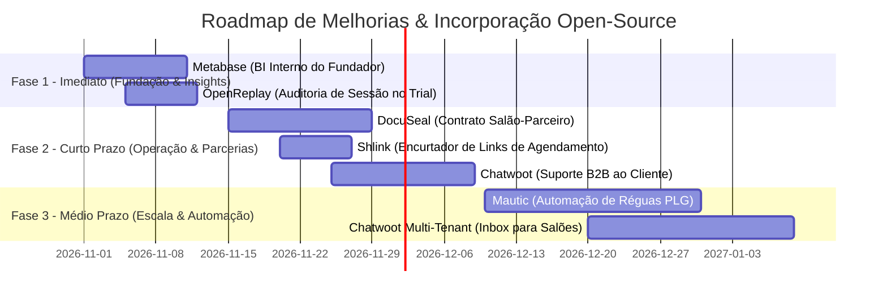

# 🧭 NEXI PRO — Análise do Ecossistema Open-Source & Roadmap de Evolução

> **Data de Elaboração:** Outubro de 2026  
> **Arquitetura Base:** Monólito Modular em Java 17 / Spring Boot 3+, PostgreSQL 16, Thymeleaf, Asaas (Billing) e Evolution API (WhatsApp).  
> **Objetivo:** Estabelecer um referencial técnico e estratégico para avaliar, priorizar e incorporar ferramentas open-source de alto impacto sem inflar custos de infraestrutura ou comprometer o isolamento multi-tenant.

---

## 📊 1. Matriz de Priorização (Impacto no Negócio vs. Facilidade de Incorporação)

A matriz abaixo classifica as ferramentas avaliadas com base no **Retorno sobre o Esforço (ROI)** e na **Complexidade de Integração** com o ecossistema atual do NEXI PRO:

| Ferramenta | Categoria | Impacto no SaaS | Facilidade / Esforço | Estratégia de Adoção Recomendada |
| :--- | :--- | :---: | :---: | :--- |
| **Metabase** | BI & Analytics | 🟢 **Muito Alto** | 🟢 **Muito Fácil** | **Fase 1 (Imediato):** Conexão direta read-only no PostgreSQL. Dashboards internos e iframes com JWT. |
| **OpenReplay** | Session Replay & UX | 🟢 **Alto** | 🟢 **Muito Fácil** | **Fase 1 (Imediato):** Injeção de script JS no layout para auditar atritos de usabilidade no trial. |
| **Chatwoot** ⭐ | Atendimento Omnichannel | 🟢 **Muito Alto** | 🟡 **Médio** | **Fase 2 (Curto Prazo):** Container Docker satélite para suporte B2B e caixa de entrada do salão. |
| **DocuSeal** | Assinatura de Contratos | 🟢 **Alto** | 🟡 **Médio** | **Fase 2 (Curto Prazo):** API/Webhook para formalizar Contratos de Salão-Parceiro (Lei 13.352/2016). |
| **Shlink** | Encurtador de Links | 🟡 **Médio** | 🟢 **Fácil** | **Fase 2 (Curto Prazo):** Container leve para rastreamento de links em disparos de WhatsApp/SMS. |
| **Mautic** ⭐ | Automação de Marketing | 🟢 **Muito Alto** | 🔴 **Complexo** | **Fase 3 (Médio Prazo):** Container dedicado para réguas de e-mail e nutrição de leads pós-trial. |
| **Docmost** | Central de Ajuda / Wiki | 🟡 **Médio** | 🟢 **Fácil** | **Fase 3 (Médio Prazo):** Base de tutoriais e manuais públicos (`ajuda.nexipro.com.br`). |
| **Node-RED** | Automação Low-Code | 🟡 **Médio** | 🟡 **Médio** | **Fase 3 (Médio Prazo):** Chatbots avançados fora de horário integrados à Evolution API. |
| **Bigcapital** | ERP Contábil | 🟡 **Médio** | ⚪ **Inspiração** | **Apenas Teórico:** Absorver regras de DRE e partidas dobradas no `FinanceiroService`. |
| **InvenTree** | Controle de Estoque | 🟡 **Médio** | ⚪ **Inspiração** | **Apenas Teórico:** Absorver alertas de ponto de pedido e controle de lotes/validade no `EstoqueService`. |
| **Lago** | Billing por Uso (Stripe) | 🔴 **Baixo** | 🔴 **Desnecessário** | **Descartar:** Asaas já atende 100% com Pix dinâmico, boletos, cartões e split nativo. |
| **EspoCRM** | CRM Tradicional (PHP) | 🔴 **Baixo** | 🔴 **Incompatível** | **Descartar:** Nosso CRM de clientes/anamnese em Spring Boot é mais rápido e integrado. |
| **LibreBooking** | Reserva legada (PHP) | 🔴 **Baixo** | 🔴 **Incompatível** | **Descartar:** Motor de agendamento em Spring Boot já é superior. |
| **MeshCentral** | Acesso Remoto | 🔴 **Nulo** | 🔴 **Incompatível** | **Descartar:** Ferramenta de suporte de desktop/rede, desalinhada com SaaS web. |
| **Dolibarr** | ERP Tradicional (PHP) | 🔴 **Baixo** | 🔴 **Incompatível** | **Descartar:** Monólito PHP pesado e burocrático para o mercado de estética e bem-estar. |

---

## 🌟 2. Análise Detalhada dos Destaques Estratégicos

### 2.1. Chatwoot (`chatwoot/chatwoot`) — Central de Atendimento Omnichannel
* **Repositório:** [https://github.com/chatwoot/chatwoot](https://github.com/chatwoot/chatwoot)
* **Stack:** Ruby on Rails, Vue.js, PostgreSQL, Redis.
* **Diagnóstico de Negócio:**
  * O ecossistema de beleza e bem-estar depende quase que 100% de conversas rápidas via WhatsApp e Instagram Direct. Atualmente, recepcionistas perdem horas trocando de abas ou usando o WhatsApp no celular pessoal.
* **Modelo de Integração no NEXI PRO:**
  * **Uso Interno (Suporte B2B):** Implantar uma instância do Chatwoot conectada ao WhatsApp oficial do NEXI PRO e com widget no painel administrativo para atender os assinantes em tempo real.
  * **Uso Externo (Add-on para os Salões):** Via API do Chatwoot, provisionar automaticamente uma *Inbox* com webhook para a Evolution API. A recepcionista gerencia conversas de múltiplos profissionais em uma tela única integrada ao histórico do cliente.
* **Decisão Arquitetural:** Não portar código. Executar como serviço satélite containerizado (Docker) compartilhado ou via Cloud gerenciada.

---

### 2.2. Mautic (`mautic/mautic`) — Automação de Marketing & Nutrição de Leads
* **Repositório:** [https://github.com/mautic/mautic](https://github.com/mautic/mautic)
* **Stack:** PHP 8+, Symfony, MySQL/MariaDB.
* **Diagnóstico de Negócio:**
  * No modelo Product-Led Growth (PLG), a ativação do usuário nos primeiros 7 dias de trial define o sucesso da conversão.
  * O Mautic permite construir réguas visuais de e-mail e webhook com pontuação de engajamento (*lead scoring*). Se o salão cadastrou 5 serviços e 1 profissional, o Mautic dispara uma parabenização com o link do seu agendamento online. Se ficou 3 dias sem logar, dispara um alerta de reativação com dicas rápidas.
* **Decisão Arquitetural:** Adotar na Fase 3 como container independente integrado via Webhooks disparados pelo `TenantInterceptor` e `EmpresaService` do NEXI PRO.

---

### 2.3. Metabase (`metabase/metabase`) — Dashboards Analíticos & BI
* **Repositório:** [https://github.com/metabase/metabase](https://github.com/metabase/metabase)
* **Stack:** Clojure / Java (JVM), compatível nativamente com PostgreSQL.
* **Diagnóstico de Negócio:**
  * Permite ao gestor do NEXI PRO visualizar métricas como LTV, CAC, MRR, taxa de conversão do trial, faturamento por região e horários de maior fluxo.
  * Permite criar relatórios interativos para donos de grandes salões através de **Embedded Analytics**: o dashboard é gerado no Metabase e embutido via `<iframe>` seguro assinado com JWT (garantindo que o parâmetro `empresa_id` filtre estritamente os dados do tenant visualizador).
* **Decisão Arquitetural:** **Adoção imediata (Fase 1).** Pode rodar apontando para uma réplica ou diretamente para o PostgreSQL com usuário read-only.

---

## 🛠️ 3. Avaliação das Ferramentas Complementares de Alto Valor

### 3.1. DocuSeal (`docusealco/docuseal`) — Assinatura Digital de Contratos
* **Aplicabilidade:** Lei do Salão-Parceiro (Lei Federal 13.352/2016).
* **Benefício:** Salões sofrem com passivos trabalhistas. Com o DocuSeal, o NEXI PRO pode oferecer a funcionalidade de gerar contratos padrão de parceria entre o dono do salão e seus profissionais (cabeleireiros, manicures), colhendo a assinatura digital pelo celular com validade jurídica e armazenamento no prontuário do profissional.

### 3.2. OpenReplay (`openreplay/openreplay`) — Observabilidade de UX & Gravação de Sessão
* **Aplicabilidade:** Auditoria de usabilidade e suporte ágil.
* **Benefício:** Ao incluir uma tag JS leve no `layout.html`, o time consegue assistir gravações anônimas de como os novos salões estão utilizando o sistema durante os 7 dias de trial. Isso identifica imediatamente botões confusos, lentidões ou pontos onde o usuário abandona o fluxo.

### 3.3. Shlink (`shlinkio/shlink`) — Encurtador de Links com Métricas
* **Aplicabilidade:** Disparos de lembretes e links de agendamento online.
* **Benefício:** Transforma URLs longas como `https://www.nexipro.com.br/studio-elegance/agendar` em links curtos do tipo `https://nxi.pro/elegance`, reduzindo caracteres em SMS/WhatsApp e fornecendo relatórios de quantos clientes clicaram no link.

---

## 🗓️ 4. Roadmap de Implementação por Fases

### Detalhamento das Entregas:

#### 🔹 Fase 1: Imediato (Baixo Esforço, Alto Valor de Gestão)
1. Conectar **Metabase** em modo somente-leitura ao PostgreSQL para acompanhamento de MRR, conversão de trial e churn.
2. Injetar snippet do **OpenReplay** nas páginas de cadastro e comanda para identificar gargalos de UX no trial.

#### 🔹 Fase 2: Curto Prazo (Diferenciais Competitivos)
1. Integrar **DocuSeal** para geração e assinatura do Contrato de Salão-Parceiro.
2. Configurar **Chatwoot** para atendimento centralizado do suporte oficial do NEXI PRO aos donos de salão.
3. Subir container leve do **Shlink** para gerar links curtos rastreáveis nos disparos de agendamento.

#### 🔹 Fase 3: Médio Prazo (Automação em Escala)
1. Implantar **Mautic** com réguas automatizadas de conversão de trial (D+1, D+3, D+5, D+7) e resgate de clientes ausentes.
2. Habilitar o módulo de Caixa de Entrada Unificada do WhatsApp no salão via integração com Chatwoot.

---

## 🛡️ 5. Diretrizes de FinOps & Governança

1. **Monólito Central Protegido:** Nenhuma ferramenta externa deve ser incorporada dentro do código Java principal. O monólito Spring Boot mantém-se enxuto, limpo e performático.
2. **Integração Exclusiva via APIs e Webhooks:** Toda comunicação com ferramentas auxiliares (Chatwoot, Metabase, DocuSeal, Asaas, WhatsApp) ocorre através de chamadas REST assíncronas com tratamento de falhas e circuit breakers.
3. **Custo Marginal Zero por Tenant:** Serviços satélites devem ser compartilhados entre os tenants (multi-tenant lógico) para manter a margem de lucro do SaaS superior a 85%.
