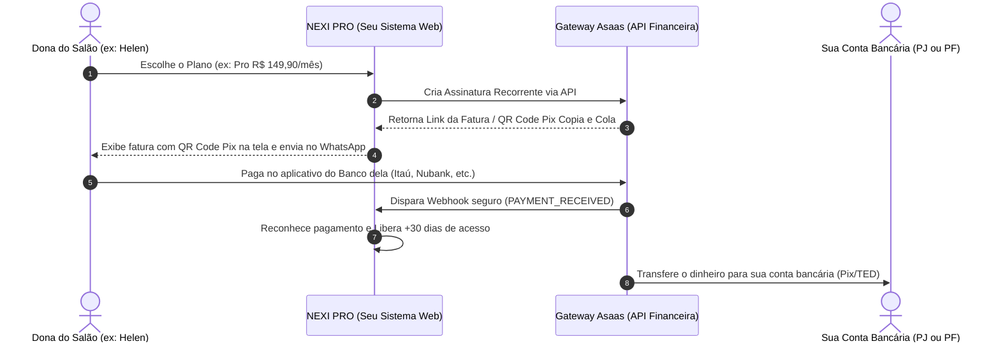

# 💳 Arquitetura Financeira NEXI PRO: Como Receber os Pagamentos Direto na sua Conta Bancária

Este documento é o **Guia Mestre de Integração Financeira do NEXI PRO**. Ele detalha como o dinheiro das assinaturas dos clientes (empresas/estabelecimentos que contratam o NEXI PRO) sai do bolso do cliente e cai **automaticamente na sua conta bancária**.

---

## 🏛️ 1. Qual Plataforma Iremos Utilizar? (Recomendação Técnica Oficial)

Para o ecossistema brasileiro de SaaS (Software as a Service) com cobranças recorrentes e Pix, a plataforma recomendada e já arquitetada no código do NEXI PRO é o **Asaas** ([www.asaas.com](https://www.asaas.com)).

### 🎯 Por que o Asaas e não PagSeguro, Mercado Pago ou Stripe?
| Critério | Asaas ✅ | Stripe ⚠️ | Mercado Pago ⚠️ |
| :--- | :--- | :--- | :--- |
| **Foco de Negócio** | Especialista em **SaaS & Mensalidades Recorrentes** no Brasil | Foco internacional, taxas de cartão mais altas no Brasil | Foco em e-commerce avulso, não em assinaturas SaaS |
| **Pix Dinâmico Instantâneo** | QR Code Pix gerado na hora com baixa taxa (R$ 0,99 a R$ 1,89 por Pix pago) | Pix com taxas mais pesadas e suporte local limitado | Funciona, mas regras de webhook de assinatura são complexas |
| **Transferência p/ sua Conta** | **Transferência automática (TED ou Pix)** para seu banco (Itaú, Nubank, Bradesco, Inter, etc.) | Prazos mais longos para compensação em conta BR | Retenções frequentes de saldo para novas contas |
| **Régua de Cobrança Automática** | Envia e-mail, SMS e WhatsApp automático lembrando o cliente de pagar a fatura | Apenas e-mail básico | Muito limitado |
| **Gestão de Inadimplência** | Suspende o acesso automaticamente via Webhook se o cliente não pagar | Exige muita programação customizada | Exige polling manual |

---

## 🔄 2. Como Funciona o Ciclo do Dinheiro (Fluxo Passo a Passo)

1. **Adesão:** A dona da empresa (ex: Helen) se cadastra no NEXI PRO e testa por 7 dias grátis.
2. **Faturamento:** No 7º dia (ou ao contratar um plano), o NEXI PRO gera a assinatura no Asaas.
3. **Pagamento:** A cliente paga via **Pix** (aprovação em 3 segundos) ou **Cartão de Crédito** (recorrência automática mensal no cartão dela).
4. **Confirmação Automática (Webhook):** O Asaas notifica o NEXI PRO instantaneamente pelo endpoint `/api/billing/webhook`.
5. **Liberação do Sistema:** O NEXI PRO muda o status da empresa para `ATIVA` e estende a data de validade por mais 30 dias.
6. **Dinheiro na sua Conta:** O dinheiro entra no seu saldo do Asaas e é **transferido automaticamente para a sua conta bancária cadastrada** (você pode configurar transferência diária ou semanal).

---

## 🚀 3. Passo a Passo Prático de Configuração (Checklist do Dono)

Para colocar o dinheiro caindo na sua conta real, siga este roteiro:

### 🔹 Etapa 1: Criar sua Conta no Asaas
1. Acesse [asaas.com](https://www.asaas.com) e crie uma conta (pode ser no seu **CPF** ou no **CNPJ** da sua empresa).
2. Envie os documentos solicitados (RG/CNH e comprovante) para homologação da conta.
3. Cadastre a sua **Conta Bancária de Destino** (onde você quer receber o dinheiro das vendas: Nubank, Inter, Itaú, Bradesco, etc.).
4. Ative a opção de **"Transferência Automática"**: assim que as mensalidades caírem no Asaas, o sistema já repassa para o seu banco.

---

### 🔹 Etapa 2: Obter as Chaves de Integração (API Key)
1. No painel do Asaas, clique na foto do seu perfil (canto superior direito) > **Configurações da Conta**.
2. Acesse a aba **Integrações** > **Chaves de API**.
3. Clique em **Gerar nova Chave de API** e copie o código gerado (`$aact_...`).
   *(Guarde com segurança, esta chave é a que autoriza o seu sistema a gerar cobranças).*

---

### 🔹 Etapa 3: Configurar o Webhook no Asaas (Para o sistema saber quem pagou)
1. Ainda na aba **Integrações** no Asaas, vá na seção **Webhooks** > **Webhook para Cobranças**.
2. Preencha os campos:
   - **URL do Webhook:** `https://www.nexipro.com.br/api/billing/webhook`
   - **E-mail para alertas:** Seu e-mail pessoal para caso o servidor fique fora do ar.
   - **Versão da API:** `v3`.
   - **Token de Autenticação do Webhook:** Crie uma senha secreta forte (ex: `NexiProSecretToken2026!`).
   - **Eventos que devem ser marcados:**
     - [x] Cobrança recebida (`PAYMENT_RECEIVED`)
     - [x] Cobrança confirmada (`PAYMENT_CONFIRMED`)
     - [x] Cobrança vencida (`PAYMENT_OVERDUE`)
     - [x] Cobrança estornada / deletada (`PAYMENT_REFUNDED`, `PAYMENT_DELETED`)
3. Clique em **Salvar Webhook**.

---

### 🔹 Etapa 4: Configurar as Variáveis no Servidor (Render)
No painel do **Render** (`dashboard.render.com`), acesse o seu serviço web do NEXI PRO e adicione as seguintes variáveis de ambiente (**Environment Variables**):

| Nome da Variável | Valor a Preencher |
| :--- | :--- |
| `ASAAS_API_KEY` | A chave de API gerada na Etapa 2 (`$aact_...`) |
| `ASAAS_WEBHOOK_TOKEN` | O token secreto criado na Etapa 3 (`NexiProSecretToken2026!`) |
| `ASAAS_ENVIRONMENT` | `PRODUCTION` (ou `SANDBOX` para testar antes com dinheiro fictício) |

---

## 💻 4. O que já está Pronto no Código do NEXI PRO e O que Faremos Agora

### ✅ O que JÁ ESTÁ IMPLEMENTADO:
1. **Model de Assinatura & Planos (`Empresa.java` e `PlanoSaaS.java`):**
   - Planos Smart, Pro e VIP já modelados com limites de profissionais e valores.
   - Campos `asaasCustomerId` e `asaasSubscriptionId` já existem no banco de dados.
2. **Recepção de Webhook (`BillingWebhookController.java` & `BillingService.java`):**
   - Endpoint `/api/billing/webhook` pronto para receber notificações do Asaas, validar o token e renovar a assinatura por +30 dias automaticamente.
3. **Controle de Acesso por Tenant (`TenantInterceptor.java`):**
   - Sistema já bloqueia acesso ou alerta inadimplência automaticamente caso a assinatura expire.

### 🔜 O que VAMOS DESENVOLVER NO PRÓXIMO PASSO (Sprint Financeira):
1. **Cliente HTTP do Asaas (`AsaasClientService.java`):**
   - Serviço Java para criar o cliente e a assinatura no Asaas automaticamente via API assim que a empresa escolhe um plano.
2. **Geração Automática do Pix / Boleto / Cartão na Tela de Assinatura:**
   - Na tela `/{slug}/assinatura`, ao clicar em "Assinar Plano", o sistema já chama a API do Asaas e exibe o QR Code Pix Copia e Cola na hora na tela.
3. **Ambiente de Testes (Sandbox):**
   - Configuração de ambiente de simulação para testar pagamentos de R$ 1,00 ou fakes antes de ligar na conta real.

---

## 📌 Resumo Prático
- **Onde o dinheiro cai?** Cai na sua conta bancária cadastrada no Asaas.
- **O que você precisa fazer agora fora do código?** Abrir a conta no Asaas (pessoa física ou jurídica) para pegar sua chave de API e cadastrar seu banco.
- **O que faremos no código?** Integrar a chamada de criação de cobrança para que o QR Code Pix apareça direto na tela para a dona da empresa pagar.
