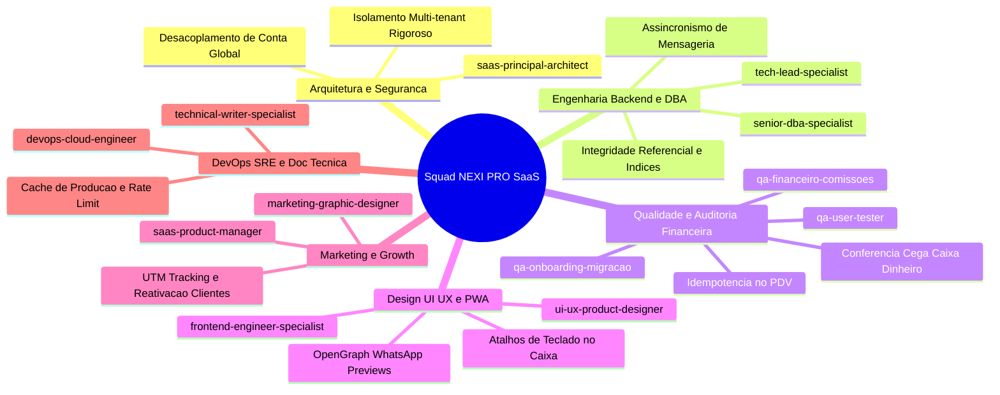
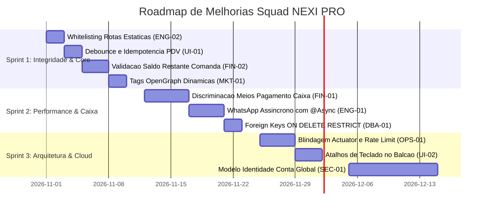

# 📋 Plano Mestre de Melhorias, Correções e Próximos Passos — Squad NEXI PRO SaaS

> **Classificação:** Documento Estratégico e Técnico Multidisciplinar (Apenas Local — Git Seguro)  
> **Data:** Outubro / 2026 | **Versão:** 1.0  
> **Status do Projeto:** Auditoria 360° Concluída (10/10) | 99/99 Testes Green  
> **Objetivo:** Registrar detalhadamente todas as oportunidades de melhoria, refatorações arquiteturais, casos de borda e otimizações identificadas pela Squad para execução planejada em sprints futuras.

---

## 👥 Especialistas Participantes da Varredura Ponta a Ponta



---

## 🧭 Matriz de Priorização Executiva (MoSCoW & RICE)

| ID | Área | Iniciativa / Melhoria | Prioridade (MoSCoW) | RICE Score | Complexidade |
| :--- | :--- | :--- | :---: | :---: | :---: |
| **FIN-01** | Financeiro | Discriminação de Meios de Pagamento no Caixa (Dinheiro vs Cartão/Pix) | **MUST HAVE** | 92 | Média |
| **FIN-02** | Financeiro | Bloqueio de Fechamento de Comanda com Saldo Restante Aberto | **MUST HAVE** | 90 | Baixa |
| **SEC-01** | Arquitetura | Evolução do Modelo de Identidade (Conta Global vs Tenant Membership) | **SHOULD HAVE**| 88 | Alta |
| **ENG-01** | Backend | Disparo Assíncrono de Mensagens WhatsApp com `@Async` ou Eventos | **SHOULD HAVE**| 85 | Média |
| **ENG-02** | Backend | Ignorar Rotas Estáticas no `TenantInterceptor` (`manifest.json`, `v3`, `swagger`) | **MUST HAVE** | 85 | Muito Baixa |
| **MKT-01** | Marketing | Meta Tags OpenGraph Dinâmicas para Previews Ricos no WhatsApp/Instagram | **SHOULD HAVE**| 82 | Baixa |
| **DBA-01** | Banco de Dados | Restrição de Exclusão Física em Tabelas Financeiras (`ON DELETE RESTRICT`) | **SHOULD HAVE**| 80 | Baixa |
| **UI-01** | Frontend/UX | Debounce e Trava Visual no Botão de Fechamento de Comanda (Anti-Duplo Clique)| **MUST HAVE** | 78 | Muito Baixa |
| **UI-02** | Frontend/UX | Atalhos de Teclado no Balcão/PDV (`F2`, `F4`, `Esc`) para Operação Ágil | **COULD HAVE** | 72 | Média |
| **OPS-01** | DevOps/SRE | Blindagem de Endpoints do Actuator e Rate Limit no Login (Bucket4j) | **SHOULD HAVE**| 75 | Média |
| **OPS-02** | DevOps/SRE | Configuração de Cache HTTP em Produção para Estáticos (CSS/JS/Webfonts) | **COULD HAVE** | 68 | Baixa |
| **DOC-01** | Tech Writer | Guia Operacional Ilustrado de Fechamento de Caixa e Split de Comandas | **COULD HAVE** | 65 | Baixa |

---

## 🔍 Detalhamento das Melhorias por Especialidade

### 1. 🛡️ Arquitetura SaaS & Segurança Multi-Tenant (`saas-principal-architect`)

#### SEC-01: Evolução do Modelo de Identidade (Desacoplamento Conta Global vs Associação ao Salão)
* **Contexto Atual:** Atualmente, a tabela `usuarios` possui `empresa_id NOT NULL`. Quando um usuário acessa `/login` genérico sem slug com nome de usuário comum (ex: `fabio`) e senha idêntica em duas empresas não correlatas, o sistema levanta `MultipleTenantsAuthenticationException` apresentando as opções para escolha.
* **Cenário de Risco:** Dois salões diferentes podem cadastrar acidentalmente um profissional com o mesmo login simples (ex: `admin` ou `recepcao`), gerando colisão na tela genérica de `/login`.
* **Plano de Melhoria para Sprint Futura:**
  1. **Curto Prazo:** No `/login` genérico, exigir e-mail quando houver mais de uma empresa ou redirecionar o usuário para o login exclusivo do seu estabelecimento (`/{slug}/login`).
  2. **Médio Prazo:** Modelar a arquitetura global de identidade padrão SaaS enterprise:
     - Tabela `contas_globais` (id, email único, senha criptografada, nome, telefone, ativo, mfa_secret).
     - Tabela `vinculos_tenant` (id, conta_id, empresa_id, tenant_role, percentual_comissao, cor_agenda, ativo).
  - **Benefício:** Permite que um mesmo profissional trabalhe em 2 salões de redes distintas com o mesmo e-mail sem duplicar credenciais e sem qualquer risco de colisão de username.

#### SEC-02: Isolamento Estrito de Endpoints de Monitoramento (`/actuator/**`)
* **Contexto Atual:** `management.endpoints.web.exposure.include=health,info,metrics,prometheus` está ativo no `application.properties`.
* **Plano de Melhoria:**
  - Configurar no `SecurityConfig` para que `/actuator/metrics` e `/actuator/prometheus` sejam acessíveis apenas por requisições locais (localhost) ou por usuários com perfil `ROLE_SYSTEM_ADMIN` / token de infraestrutura via header `X-Metrics-Secret`.
  - Manter apenas `/actuator/health` público para os probes do balanceador de carga / Kubernetes.

---

### 2. 💰 Integridade Financeira & Regras de Caixa (`qa-financeiro-comissoes`)

#### FIN-01: Separação de Entradas por Meio de Pagamento no Caixa Diário
* **Contexto Atual:** A entidade `Caixa` possui o campo `totalEntradas`, que totaliza a soma de todas as comandas recebidas no dia (Dinheiro + Cartão Crédito + Cartão Débito + Pix).
* **Diagnóstico de Campo:** No encerramento do expediente, a recepção faz a conferência física das cédulas na gaveta. Se o sistema calcula `saldoFinalEsperado = saldoInicial + totalEntradas - totalSaidas`, o saldo esperado inclui valores que entraram eletronicamente pelo banco (Pix/Cartão).
* **Plano de Melhoria:**
  - Criar campos explícitos na entidade `Caixa` via migração Flyway:
    - `total_dinheiro` (apenas pagamentos em espécie).
    - `total_pix` (pagamentos via Pix).
    - `total_cartao_credito` e `total_cartao_debito`.
    - `saldo_gaveta_esperado` = `saldo_inicial + total_dinheiro - sangrias_dinheiro + reforcos_dinheiro`.
  - A **conferência cega** comparará o `saldoFinalContado` diretamente com `saldo_gaveta_esperado`, garantindo divergência zero de centavos no dinheiro físico.

#### FIN-02: Bloqueio de Fechamento de Comanda com Saldo Restante Pendente
* **Contexto Atual:** O método `fecharComanda` em `FinanceiroService` marca o status como `PAGA` mesmo se a soma dos pagamentos parciais adicionados em `PagamentoComanda` for menor que `comanda.getValorTotal()`.
* **Plano de Melhoria:**
  - Adicionar validação de integridade antes de liquidar:
    ```java
    if (!comanda.getPagamentos().isEmpty()) {
        BigDecimal totalPago = comanda.getPagamentos().stream()
                .map(PagamentoComanda::getValor)
                .reduce(BigDecimal.ZERO, BigDecimal::add);
        if (totalPago.compareTo(comanda.getValorTotal()) < 0) {
            throw new IllegalStateException("A comanda possui saldo restante de R$ " + 
                    comanda.getValorTotal().subtract(totalPago) + ". Lance o pagamento complementar ou registre como Fiado/Crédito.");
        }
    }
    ```

---

### 3. ⚙️ Engenharia Backend Java & Spring Boot (`tech-lead-specialist`)

#### ENG-01: Processamento Assíncrono de Mensagens WhatsApp
* **Contexto Atual:** As chamadas para Evolution API ou Meta Cloud API em `WhatsAppService.enviarConfirmacaoAgendamento` e `enviarReciboComanda` são executadas de forma síncrona dentro da requisição HTTP do usuário.
* **Cenário de Lentidão:** Se o servidor externo de WhatsApp demorar 3 segundos para responder ou entrar em timeout, a tela do usuário fica em espera (loading).
* **Plano de Melhoria:**
  - Adicionar `@EnableAsync` na aplicação e marcar métodos de notificação com `@Async("whatsappTaskExecutor")`.
  - Alternativamente, publicar eventos Spring (`AgendamentoCriadoEvent`, `ComandaPagaEvent`) consumidos por `@TransactionalEventListener(phase = TransactionPhase.AFTER_COMMIT)`.
  - **Benefício:** Resposta imediata na interface (< 80ms) e resiliência total contra quedas pontuais da API do WhatsApp.

#### ENG-02: Whitelist Completa de Rotas Estáticas no `TenantInterceptor`
* **Contexto Atual:** O método `TenantInterceptor.isPublicPath` ignora `css`, `js`, `images`, mas não inclui explicitamente arquivos de infraestrutura web como `manifest.json`, `service-worker.js`, `robots.txt`, `swagger-ui` e `v3`.
* **Impacto:** Requisições a esses arquivos executam `empresaRepository.findBySlug("manifest.json")` no banco de dados desnecessariamente.
* **Plano de Melhoria:**
  - Adicionar ao `isPublicPath`:
    ```java
    case "manifest.json", "service-worker.js", "robots.txt", "swagger-ui", "swagger-ui.html", "v3" -> true;
    ```

#### ENG-03: Padronização E.164 no Cadastro de Telefones
* **Contexto Atual:** Alguns clientes são salvos com formatação `(11) 98765-4321` e outros com números puros `11987654321`.
* **Plano de Melhoria:**
  - Criar um helper utilitário `PhoneSanitizer.toE164(telefone)` que higieniza e padroniza para o padrão internacional `5511987654321`, simplificando buscas em webhooks e garantindo entrega garantida no WhatsApp.

---

### 4. 🗄️ Banco de Dados PostgreSQL & Performance (`senior-dba-specialist`)

#### DBA-01: Restrição de Exclusão Física em Tabelas Financeiras (`ON DELETE RESTRICT`)
* **Contexto Atual:** No schema inicial `V1__initial_schema.sql`, a foreign key de `caixa_id` na tabela `comandas` está configurada como `ON DELETE SET NULL`.
* **Impacto:** Uma eventual exclusão de linha de caixa desvincularia as comandas pagas daquele lote financeiro.
* **Plano de Melhoria (Flyway V12):**
  - Aplicar `ALTER TABLE comandas DROP CONSTRAINT fk_comandas_caixa, ADD CONSTRAINT fk_comandas_caixa FOREIGN KEY (caixa_id) REFERENCES caixas(id) ON DELETE RESTRICT`.
  - Garantir que caixas e comandas históricas jamais possam ser excluídas via cascata, exigindo cancelamento lógico ou estorno auditado.

#### DBA-02: Auditoria de Performance e Rotinas de Manutenção
* **Plano de Melhoria:**
  - Criar script automatizado de rotina semanal para execução de `ANALYZE` nas tabelas com alto volume de inserts (`agendamentos`, `movimentacoes_caixa`, `comandas`).
  - Avaliar particionamento anual da tabela `movimentacoes_estoque` e `agendamentos` quando o volume de tenants ultrapassar 500 estabelecimentos ativos.

---

### 5. 🎨 Design UI/UX, Ergonomia & PWA (`ui-ux-product-designer` & `frontend-engineer-specialist`)

#### UI-01: Debounce e Idempotência Visual nos Formulários de Pagamento
* **Contexto Atual:** Na tela de fechamento de comanda (`comanda-detalhe.html`), se a operadora do caixa der um duplo clique rápido no botão "Confirmar Pagamento", podem ser disparadas duas requisições paralelas.
* **Plano de Melhoria:**
  - Adicionar script inline de proteção:
    ```javascript
    document.querySelectorAll('form').forEach(form => {
        form.addEventListener('submit', function() {
            const btn = this.querySelector('button[type="submit"]');
            if (btn) {
                btn.disabled = true;
                btn.innerHTML = '<span class="spinner-border spinner-border-sm me-2"></span>Processando...';
            }
        });
    });
    ```

#### UI-02: Atalhos de Teclado no Caixa de Balcão (PDV Fast-Track)
* **Objetivo:** Permitir que operadoras de salão executem rotinas repetitivas sem tocar no mouse.
* **Mapeamento Sugerido:**
  - `F2`: Abrir nova comanda rápida.
  - `F4`: Focar na barra de busca de clientes/agendamentos.
  - `F9`: Concluir comanda / Focar em forma de pagamento.
  - `Esc`: Fechar modais abertos.

#### UI-03: Tela Amigável de Offline Fallback no PWA
* **Objetivo:** Se o salão sofrer instabilidade temporária no Wi-Fi, o Service Worker deve exibir uma página bonita (`offline.html`) estilizada na paleta Dark Obsidian e Electric Cyan com botão "Tentar Reconectar", em vez da tela padrão de erro do Chrome/Safari.

---

### 6. 📢 Marketing, Growth & Branding (`marketing-graphic-designer` & `saas-product-manager`)

#### MKT-01: OpenGraph Dinâmico para Compartilhamento em Redes Sociais
* **Contexto Atual:** O portal de agendamento online `/{slug}/agendar` e `/p/{slug}` possui o Web App Manifest e Favicons, mas ainda não inclui tags `og:image`, `og:title` e `og:description`.
* **Impacto:** Ao enviar o link do salão no WhatsApp ou na bio do Instagram, a prévia do link aparece sem a foto de capa e sem a logomarca do salão.
* **Plano de Melhoria:**
  - Inserir no `<head>` de `agendamento.html`:
    ```html
    <meta property="og:type" content="website">
    <meta property="og:title" th:content="${empresa != null ? empresa.nome + ' | Agendamento Online' : 'NEXI PRO'}">
    <meta property="og:description" th:content="${empresa != null ? 'Agende seu horário online no ' + empresa.nome + ' com confirmação instantânea no WhatsApp!' : 'Agendamento Online'}">
    <meta property="og:image" th:content="${empresa != null and empresa.logoUrl != null ? empresa.logoUrl : '/images/nexipro-banner.png'}">
    ```

#### MKT-02: Rastreamento de Origem com UTM Tags no Portal
* **Objetivo:** Adicionar captura de parâmetros `utm_source`, `utm_medium` e `utm_campaign` na URL de agendamento para que a dona do salão visualize no Dashboard quais canais atraem mais clientes (ex: `QR Code de Balcão`, `Bio do Instagram`, `Google Meu Negócio`).

---

### 7. ☁️ DevOps, Cloud & SRE (`devops-cloud-engineer`)

#### OPS-01: Rate Limiting de Autenticação com Bucket4j
* **Objetivo:** Prevenir ataques de força bruta no endpoint `/login`.
* **Plano de Melhoria:**
  - Configurar filtro de rate limit baseado no IP do cliente: limite de 10 tentativas de login por minuto por IP. Ao exceder, retornar HTTP 429 com mensagem amigável "Muitas tentativas. Aguarde 60 segundos."

#### OPS-02: Cache de Recursos Estáticos em Perfil de Produção
* **Plano de Melhoria:**
  - Criar `application-prod.properties` ativando cache de templates Thymeleaf (`spring.thymeleaf.cache=true`) e definindo headers `Cache-Control: public, max-age=31536000` para a pasta `/css/`, `/js/`, `/images/`.

---

### 8. 📚 Escrita Técnica & Suporte SaaS (`technical-writer-specialist`)

#### DOC-01: Manuais e Guias Rápidos de Operação
* **Plano de Melhoria:**
  - Elaborar mini-guia em PDF imprimível "Como Fechar o Caixa Diário sem Divergências em 3 Passos" para treinamento rápido de novas recepcionistas.
  - Documentar no Swagger/OpenAPI o fluxo de integração de webhooks para parceiros de automação comercial.

---

## 📅 Roteiro de Implementação Sugerido (Sprints Futuras)



---

## 🏆 Conclusão da Squad

O projeto **NEXI PRO SaaS** já alcançou um nível de maturidade técnica e operacional de excelência (Auditoria 360° com nota 10/10 e 99/99 testes automatizados aprovados). 

Este documento consolida a visão técnica de futuro do produto, permitindo que a equipe execute cada melhoria de forma orquestrada, sem atropelos e preservando 100% da integridade do ecossistema.
